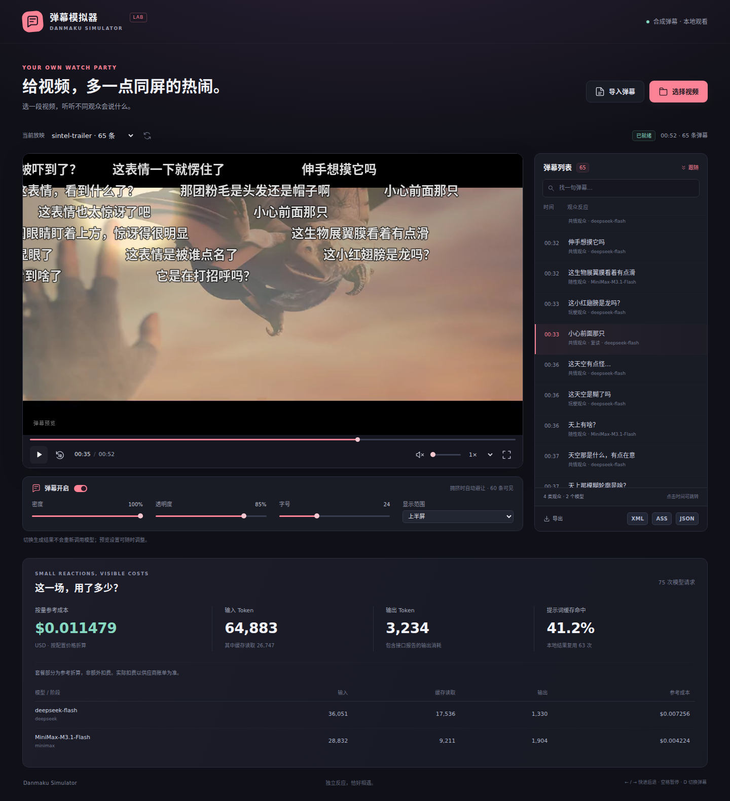

# Danmaku Simulator · 弹幕模拟器

**给本地视频生成一群观众的即时反应。** 先理解对白和关键画面，再让不同模型、不同性格的观众独立生成中文短弹幕，最后安排反应延迟、少量复读和显示密度。

项目处于可运行原型阶段。当前重点是检验相关性、时间和观看体验，并让每次实验的 token 与成本能够追溯。

**0.2 新增：**少量弹幕接话、可版本化的本地/远端弹幕目录、HTML5 视频用户脚本，以及电视播放器同名 XML 导出。生成、分发和客户端在同仓分模块维护；实际视频与个人弹幕库独立存放。

[分发与数据组织](docs/DISTRIBUTION.md) · [网页端安装与使用](clients/browser/README.md) · [互动生成](docs/INTERACTIONS.md) · [电视播放器适配](docs/TV_PLAYER_ADAPTER.md)

首个真实样例已完成：52 秒 Sintel 预告片，**63 条独立弹幕 + 2 条受控复读**，含一份 STT 的完整参考成本约 **$0.017**。这是单个样本的测量，并非账单实扣或观看质量保证。详见[实测报告](docs/EXPERIMENT_2026-11-06.md)。



画面 © Blender Foundation / Durian Open Movie Project，CC BY 3.0；中文 AI 弹幕与界面叠层由本项目添加。

## 已有能力

- **视频分析**：ffprobe 元数据、MiniMax STT 或导入 JSON/SRT/VTT；混合选帧或全片均匀抽帧；可并发调用视觉模型生成观察。
- **独立观众**：按 persona、模型与采样轮次分别请求；角色说明放在共同证据之后；允许安静和不发言。
- **时间约束**：只给观众当前检查点之前的证据。每条弹幕记录触发事件、观众、模型和已知信息截止时间，调度器不允许早于该时间发出。
- **可控复读**：短句可在小范围内跟风，保留父弹幕来源；不会把所有相同文本一律去重。
- **少量互动**：可选的第二阶段让另一位观众接一句已出现的弹幕，默认只接一层；预留空位后才请求，保留父子关系并单独统计费用。
- **输出**：JSON、Bilibili 风格 XML、滚动弹幕 ASS；只读网页预览支持暂停、拖动、倍速、密度、透明度、字号和显示区域。
- **成本可观测**：逐请求保存输入、输出、缓存读取/写入、时延、阶段、模型、错误和价格快照；区分本地结果复用与提供方提示词缓存。
- **分发与消费**：同一份目录可放本地、NAS 或静态 HTTP；网页用户脚本读取文件、直链或目录；电视通过已校准的同名 XML 接入。
- **轻量运行**：Python 3.11+ 标准库，额外仅需 ffmpeg / ffprobe；网页无 CDN 和构建依赖。

模型接口支持 OpenAI Chat Completions 兼容协议和 Anthropic Messages 兼容协议。配置示例使用 MiniMax M3.1 Flash 与 DeepSeek Flash；可替换供应商、模型、参数、观众比例和采样轮数。

## 在已有视频网站使用

安装[用户脚本](clients/browser/README.md)后，在普通 HTML5 视频页面打开“弹幕模拟器”面板，导入本地 JSON/XML，或读取自己选定的弹幕地址/目录。脚本只负责叠加显示，视频仍由原站播放；不会向网站发送评论。

仓库附有[两条真实生成轨道](examples/catalog/)：标准版 65 条，少量互动版 68 条。公开 HTTPS 样例目录可作为远端源：

```text
https://raw.githubusercontent.com/AxelHu/danmaku-simulator/main/examples/catalog/catalog.json
```

这些轨道只对应提供的 Sintel 预告片版本，不能直接套到任意同名长片。B 站分 P 和其他剪辑需要明确匹配与对轴。网页端的实际验收范围与兼容边界见客户端 README。

## 快速开始

安装 Python 3.11+、ffmpeg，然后在仓库根目录运行。无需先安装 Python 依赖。

先看已经生成的真实结果，不需要密钥：

```bash
python3 tools/prepare_sintel_demo.py
python3 -m danmaku_sim serve --port 8793
# http://127.0.0.1:8793/?run=sintel-recorded
```

准备脚本下载约 4.2 MiB 的 CC BY 3.0 视频并校验哈希，已有同一视频可加 `--video PATH`。该样例展示的是历史用量，回放不发起模型请求。文件与素材署名见 [examples/sintel](examples/sintel/)。

不下载视频也可以使用手工界面夹具，或在网页中选择自己的本地视频与 JSON：

```bash
# 无密钥界面样本：这是手工夹具，不冒充模型生成结果。
python3 -m danmaku_sim demo --out runs/demo
python3 -m danmaku_sim serve --port 8793
```

打开 <http://127.0.0.1:8793>。可以直接选择本地视频与弹幕 JSON，文件只在浏览器内读取。视频能否解码取决于浏览器；HEVC/MKV 等素材可先转为 H.264/AAC MP4，或将 XML/ASS 交给外部播放器。

### 处理真实视频

复制 `configs/example.json`，按自己的账号修改模型、计费模式和语言。示例将 MiniMax 标记为订阅、DeepSeek 标记为按量；使用其他账号时应改成实际计费渠道。

```bash
cp configs/example.json config.local.json
# 在环境中设置 MINIMAX_API_KEY 和 DEEPSEEK_API_KEY。
# .env.example 仅示意变量名；程序不会自动加载 .env。

# 查看请求规模；不会调用 API。
python3 -m danmaku_sim plan --config config.local.json --duration 600

# 一次跑通分析、生成、导出。
python3 -m danmaku_sim run video.mp4 \
  --config config.local.json --out runs/video-first

# 已有字幕时不必重复做 STT。
python3 -m danmaku_sim run video.mp4 \
  --transcript subtitles.srt --config config.local.json --out runs/video-subtitles

# 更换观众后复用素材分析；新输出目录保留独立账本。
python3 -m danmaku_sim generate \
  --analysis runs/video-first/analysis.json \
  --config config.local.json --out runs/video-second

python3 -m danmaku_sim costs runs/video-first
python3 -m danmaku_sim serve --port 8793
```

向明确配置的模型 API 发送音轨或关键帧只发生在 `analyze` / `run` 中。`generate` 发送已生成的文字证据；预览服务只读，不提供远程生成或任意文件读取入口。默认服务仅监听本机；在可信局域网预览可显式添加 `--host 0.0.0.0`。

程序不会自动改用另一密钥、账户或模型。失败调用写入账本；超时的计费状态可能未知，不会按零费用处理。重新运行会复用已有成功响应，失败请求才需要再执行。

### 长视频的抽帧与视觉并发

`configs/example.json` 保持原来的混合选帧与串行视觉分析。处理长视频时，可将下面这些字段合并到自己的 `analysis` 配置中，并保留已有 `vision_provider`：

```json
{
  "analysis": {
    "sampling_mode": "uniform",
    "frame_interval": 18,
    "max_frames": 320,
    "vision_concurrency": 3
  }
}
```

`sampling_mode` 默认为 `mixed`，结合周期点、场景切换和对白提示选帧；`uniform` 按时间均匀分配帧预算，覆盖开场和片尾附近，触及 `max_frames` 后扩大间隔。均匀模式跳过场景切换扫描和对白提示选帧，适合希望控制长片解码工作与请求数量的情况。它仍是稀疏单帧观察，不能保证捕捉每个短动作。

`vision_concurrency` 默认为 1，可设为 1–8，控制帧提取与视觉请求的并发上限。普通 `analyze` / `run` 仍先完成 STT 或字幕导入，再处理视觉；这个参数仅并发视觉阶段。每完成一帧就更新 `frames.json`，成功响应可在续跑时复用。续跑允许单独调整并发数；改变其他分析设置时使用新运行目录。配置范围、音轨选择和恢复约定见 [架构说明](docs/ARCHITECTURE.md)。

词级时间戳也可能与实际音频错位；长片应核对声画锚点，并优先导入已经校验过的字幕。

### 给已有结果加少量接话并分发

```bash
# 保留原运行；新账本只统计此次新增互动。
python3 -m danmaku_sim interact --run runs/video-first \
  --config config.local.json --out runs/video-social

python3 -m danmaku_sim publish runs/video-social \
  --library published --track-id social --label '少量互动'

# 本地预览加分发。
python3 -m danmaku_sim serve --port 8793 --library published
# 只提供弹幕目录时，加 --catalog-only；视频与运行预览路由会关闭。
```

互动默认关闭；`interact` 命令明确启用这一阶段。原 `run` / `generate` 则只在配置 `interactions.enabled=true` 时追加互动。当前真实实验新增 3 条接话、3 次调用，参考费 $0.00058329；原 65 条弹幕未改变，详见[本轮记录](docs/INTERACTION_DISTRIBUTION_EXPERIMENT_2026-11-06.md)。

## 观众与时间

示例包含随手看、细节党、轻吐槽、共情党四类观众。它们不是相互对话的四个长会话，而是独立读入同一时点的信息，再分别产生反应。`rounds` 增加新的采样轮次；直接重跑相同配置主要用于恢复和结果复用。

B 站风格的目标是短句、口语、针对当前片段的具体反应。不是所有观众都吐槽，也不是每帧都必须发言。复读发生在聚合后，不让一个模型先替整群观众定调。

人工复读默认限制为不超过 8 字符（`echo_max_chars`），并在父弹幕后 2 秒内出现（`echo_max_parent_delay`）；密度限制下排不进去就放弃。不同观众独立产生的同文仍按事件内次数上限保留。

示例配置按事件触发；一句对白在结束后才进入已知信息，视觉观察在截帧时刻进入。相距不超过一秒的事件可合并，检查点取最后一个事件的时间；黑场与低信息片头只保留在历史中，不专门触发请求。也可选择 `checkpoint_mode: "window"` 使用固定窗口，减少请求数。检查点内的评论都在该检查点之后显示，不会为了“贴近画面”把看过后续信息的评论倒排回过去。

模型自身的既有作品知识仍可能引发剧透，所以提示词不提供作品名，并要求只使用观察证据；这不是对所有语义剧透的绝对保证。观众默认短句为主，`max_text_chars` 可配置。

## 缓存和成本

| 层次 | 复用什么 | 如何记录 |
| --- | --- | --- |
| 媒体与观察缓存 | 音轨片段、STT、抽帧、视觉观察 | 内容哈希、参数与完成记录 |
| 模型提示词缓存 | 多观众共享的相同输入前缀 | 只以供应商返回的缓存 token 为准 |
| 完整响应缓存 | 完全相同请求的既有结果 | `local_cache_hit`，不计为新的采样或 API 调用 |
| 受控复读 | 已生成的少量短弹幕 | 关联父弹幕，不产生新的模型 token |

提示词缓存减少输入费用，不免除新输出费用；跨供应商不会共享缓存。角色、轮次等变化放在提示末尾，有利于相同前缀命中，但不保证缓存一定命中。没有人为填长提示词来凑缓存门槛。

`usage.jsonl` 是实际请求的追加账本。价格字段用于**按量参考成本**，不是账单实扣；订阅消耗与按量部分单独汇总。缺失用量或价格会标为未知，推理 token 视为输出 token 的子集，不重复相加。DeepSeek 示例使用核验日期的峰时价格，非峰时实际价格可能更低；更改价格快照应使用新配置。

参考文档：[MiniMax 价格](https://platform.minimax.io/docs/pricing/overview)、[MiniMax 缓存口径](https://platform.minimax.io/docs/api-reference/text-prompt-caching)、[DeepSeek 价格](https://api-docs.deepseek.com/quick_start/pricing/)。

## 运行产物

`runs/<name>/` 包含 `analysis.json`、`transcript.json`、`frames.json`、`comments.json`、`export.xml`、`export.ass`、`usage.jsonl` 和 `usage-summary.json`。原始响应、素材路径和账号相关运行信息都留在忽略目录，不随源码发布。

`comments.json` 的每条弹幕包含 `time`、`text`、`persona`、`provider`、`model`、`event_id` 和 `knowledge_cutoff`。这使质量问题能够追到产生它的证据和请求，而不只看到一句脱离来源的文本。

## 当前边界

- 单张关键帧不能准确说明连续动作、速度、配乐或声效。动作密集内容后续应增加短帧序列或音频事件识别。
- STT 与视觉描述可能出错；长音频按片段转写，重叠边界和少量音画错位仍需抽样核验。明显不同的音画起点会要求先提供对齐字幕或归一化媒体。
- 目前没有训练专用弹幕模型，没有引入爬取弹幕语料，也没有宣称通过“像真人”评测。观看体验需要多类视频和用户验收。
- 生成通过 CLI 启动，本地网页用于实验预览，用户脚本用于已有 HTML5 视频页面。跨 iframe、封闭播放器与所有网站的兼容性尚未覆盖；复杂弹幕样式可进一步使用成熟转换工具。

## 相关工作

[Asteria](https://github.com/KikoPlayProject/Asteria) 已覆盖本地视频、VLM、LLM、人设与 XML，是最直接的同类参照。本项目重点验证 STT + 视觉证据、独立多观众采样、因果时间编排和成本账本。

[DanmakuFactory](https://github.com/hihkm/DanmakuFactory) 可用于更完整的弹幕转换，[DPlayer](https://github.com/DIYgod/DPlayer) 是成熟的浏览器弹幕播放器。研究与其他组件对照见 [相关项目调查](docs/RELATED_PROJECTS.md)。目前实现未复制这些仓库的代码。

## 开发验证

```bash
python3 -m unittest discover -s tests -v
node --check web/app.js
node --check clients/browser/danmaku-simulator.user.js
node --test tests/browser/*.test.cjs
```

测试覆盖时间因果、密度与复读、单层互动、独立账本、目录发布、时间映射、导出、用量口径、异常响应、媒体身份和只读服务边界。浏览器验收步骤见客户端 README；真实 API 实验另记于 `docs/`，不把测试夹具当作真实质量样本。

架构与数据约定见 [ARCHITECTURE.md](docs/ARCHITECTURE.md)，公开真实样例见 [EXPERIMENT_2026-11-06.md](docs/EXPERIMENT_2026-11-06.md)。

MIT License。公开视频示例的素材权利归各原作者，按其原许可使用。
