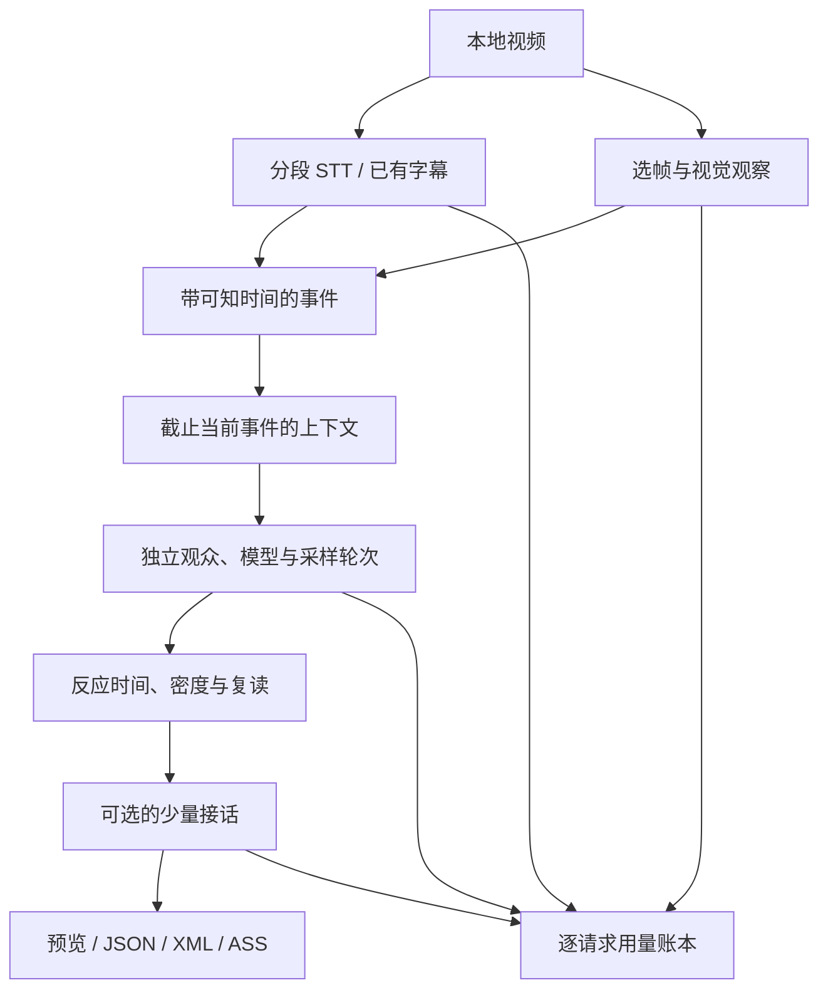

# 数据与运行架构

## 处理路径



视频分析一次，多个观众复用同一份带时间的证据。生成阶段没有共享的群聊历史：其他观众先写了什么，不会影响独立采样。受控复读由后处理增加，并保留父弹幕和新的虚拟观众身份。

可选互动在独立弹幕完成后执行，每次只向另一位观众提供一条已出现的父弹幕和当前证据；它不回写独立采样上下文。调用前先预留合法密度位置，费用单列为 `interaction`。详见 [INTERACTIONS.md](INTERACTIONS.md)。

## 模块

| 文件 | 职责 |
| --- | --- |
| `media.py` | 探测视频、字幕导入、STT 分块、选帧与视觉事件 |
| `providers.py` | 明确配置的模型请求、响应缓存、实际用量留账 |
| `engine.py` | 因果上下文、独立观众任务、JSON 解析和候选过滤 |
| `scheduler.py` | 反应延迟、任意一秒窗口密度上限、受控复读 |
| `interactions.py` | 有预算的单层接话、父子关系、独立用量 |
| `exporters.py` | XML、ASS、JSON 与导出丢弃报告 |
| `distribution.py` | 轻量轨道、版本化目录、精确匹配候选、同名 XML |
| `costs.py` | 供应商/模型/阶段汇总、订阅与按量参考成本 |
| `server.py` / `web/` | 只读运行预览、HTTP Range、媒体时间驱动的 Canvas |
| `clients/browser/` | 已有 HTML5 视频页面的文件/远端轨道消费端 |

## 时间数据

分析结果的 `schema_version` 为 1。

```json
{
  "schema_version": 1,
  "video": {"id": "sha256-of-source", "title": "video", "duration": 60},
  "transcript": [{"id": "s0", "start": 2, "end": 4, "text": "一段对白"}],
  "events": [{
    "id": "s0", "start": 2, "end": 4, "available_at": 4,
    "kind": "speech", "text": "一段对白", "salience": 0.6,
    "uncertain": false
  }]
}
```

`available_at` 表示观众最早何时可以知道完整信息。对白取句段结束，单帧视觉取该帧时间。生成器只给当前检查点之前的事件，不提供全文总结或之后的画面。

`checkpoint_mode: events` 按事件安排调用；相距很近的事件可合并，合并组跨度不超过 `event_merge_seconds`，检查点取组内最晚时间。低于 `min_trigger_salience` 的事件可进入历史，不会单独触发付费任务。`checkpoint_mode: window` 是更省调用的固定窗口方案。

候选与最终弹幕均带 `event_id`、`knowledge_cutoff`、`persona`、`provider`、`model` 和 `synthetic`。候选保留 `source_event`。即使候选评论一个较早事件，调度时间仍不能早于它实际看到的完整上下文截止时间。

原始模型输出、观察和候选均可能不准确。时间约束防止提前发出已知后续内容，不等于证明每句弹幕的语义无误。

受控复读只选不超过 `echo_max_chars`（默认 8）字符的反应、情绪或笑话。最晚时间取视频结尾、原 `knowledge_cutoff + max_delay`、父弹幕时间加 `echo_max_parent_delay`（默认 2 秒）三者最小值；密度挤不进去便丢弃，不改变独立弹幕的位置。

## 独立性与可复现

persona × provider × round × checkpoint 分别调用。共同系统提示、当前证据在前，人设和采样轮次在后。相同请求可复用完整结果；增加 `rounds`、改变 seed/persona/model 或提示词会改变请求身份，产生新的采样。

模型的采样不是确定性保证。已生成的候选采用固定 seed 调度，输入候选顺序变化不会改变既定时间结果。重跑完全相同请求用于恢复，不应把它统计成更多独立观众样本。

## 用量与费用

账本保存每次实际请求。OpenAI 兼容的 `prompt_tokens` 通常含缓存输入；Anthropic 兼容的 `input_tokens` 是新输入，缓存读取和写入另列。先统一成互不重叠的 token 分类，再计算价格。

```
参考成本 = 新输入 × 输入单价
         + 缓存读 × 缓存读单价
         + 缓存写 × 缓存写单价
         + 输出 × 输出单价
```

上述 token 单价按百万计。推理 token 是输出的细分，不再加一次。STT 用实际发送的音轨时长估算，重叠部分也计入。原始账单不可读时 `actual_cost` 为 null；缺用量或价格的请求标为未知。订阅用量与按量收费分别汇总，不把套餐消耗伪装成零资源成本。

本地响应复用的新增 API 请求数为 0，与供应商的提示词缓存命中严格分开。价格快照与请求一起保存，后续价格变化不改写旧记录。

## 失败与运行身份

- 单个模型或视觉观察失败保留其他结果，整体标为 `partial`，CLI 返回 2。
- 所有生成请求均失败时退出失败，保存诊断与用量，不用离线样本替代。
- 请求已返回但 JSON 不合法，仍计入调用账本；异常响应和未知费用不丢掉。
- 同一输出目录不能改绑另一个视频。切换分析参数或做独立比较时使用新的运行目录。
- `runs/`、`.local/`、`.env` 和缓存都不提交。公开预览接口不暴露原始配置、完整响应和媒体绝对路径。

## 预览 API

| 路径 | 返回 |
| --- | --- |
| `GET /api/runs` | 运行列表、时长、弹幕数与状态 |
| `GET /api/runs/<id>` | 当前弹幕、媒体信息、用量汇总、诊断 |
| `GET /api/runs/<id>/video` | 显式绑定的视频，支持 Range / HEAD |
| `GET /api/runs/<id>/export.json` | 清理媒体路径后的弹幕数据 |
| `GET /api/runs/<id>/export.xml` | Bilibili 风格 XML |
| `GET /api/runs/<id>/export.ass` | 滚动弹幕 ASS |

只有上述固定路由。预览没有生成 API，不接受远程任意路径。浏览器选择本地文件时使用 Blob，既不会上传，也不会按导入 JSON 里的 URL 自动访问网站。

提供 `--library` 后额外开放 `/catalog/catalog.json` 与固定格式版本文件路径。`--catalog-only` 关闭上述全部预览/运行/视频接口，仅分发已经发布的目录。轨道文件不含视频、运行配置与原始证据。分发协议、时间映射和客户端边界见 [DISTRIBUTION.md](DISTRIBUTION.md)。
