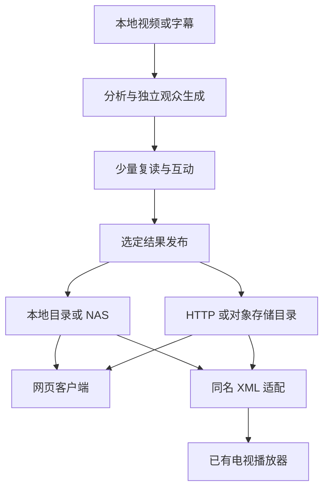

# 弹幕分发、目录与客户端

## 仓库边界

目前在同一个仓库维护生成、分发协议、网页客户端和播放器适配。它们共享弹幕字段、时间轴和样例，早期一起改动、一起验证更直接。不同模块可以单独运行；使用已生成弹幕的人无需模型 API 密钥。

| 内容 | 放在哪里 | 原因 |
| --- | --- | --- |
| 生成器、互动生成、调度、成本统计 | `danmaku_sim/` | 生产弹幕，并保留来源与用量 |
| 弹幕轨、目录、发布与同名 XML 导出 | `danmaku_sim/distribution.py` | 为不同消费者提供同一份内容 |
| 网页使用端 | `clients/browser/` | 加到已有 HTML5 视频上，不接管原站播放器 |
| 本地实验预览 | `web/` | 查看结果、比较配置和费用 |
| 播放器接入说明 | `docs/TV_PLAYER_ADAPTER.md` | 复用播放器已支持的格式与查找规则 |
| 少量可公开样例 | `examples/` | 无密钥复现、协议兼容性和质量讨论 |
| 实际视频、原始响应、私人分析、个人弹幕库 | 仓库外或忽略目录 | 内容可独立备份、搬迁和部署，避免 Git 不断膨胀 |

默认 `runs/` 和 `published/` 都不提交。仓库公开不等于自动公开用户生成的内容。`publish` 只导出明确选定的运行，不会遍历 NAS 或发布整个 `runs/`。

当浏览器扩展或 Android 客户端有独立维护者、独立发布节奏时，可以把客户端移到其他仓库；`danmaku-track/v1` 和 `danmaku-catalog/v1` 是兼容边界，无需把生成服务一起拆开。



## 内容如何组织

需要区分三件事：**视频版本、弹幕轨、客户端绑定**。

- **视频版本**：同一作品不同剪辑、片头长度、分 P 和播放速度可能有不同时间轴。本地源视频由生成时的内容哈希标识；重新编码会改变文件哈希，因此网页版本使用明确的 BVID + 分 P/CID 或稳定页面 URL 关联，不能要求网页播放器取得原文件哈希。
- **弹幕轨**：同一视频可有“稀疏”“标准”“少量互动”等多个版本。`track_id` 区分轨道；内容变化产生新的 `revision`，旧版本文件不会被原地覆盖。
- **客户端绑定**：标题便于检索，不足以自动认定是同一段视频。B 站需要区分分 P；只提供 BVID 的查询返回候选，不能视为精确选中。时长检查是额外的对轴提示，也不是内容一致的证明。

作品名、季集信息、语言和标签将来可以扩充检索，但不替代视频身份和对轴记录。首版不爬取网站目录、不把带签名的临时媒体 URL 当稳定绑定。

## 本地和远端使用同一目录

发布目录包含 `catalog.json` 和 `tracks/<media_key>/<track_id>/<revision>/`。每个版本下是 `comments.json`、`comments.xml`、`comments.ass`。

目录清单只引用相对路径，包含每个文件的 SHA-256、字节数和弹幕数。因此整份目录可以直接复制到移动磁盘/NAS，或放到普通静态 HTTP 服务、HTTPS 对象存储。首版不需要数据库、账号系统或常驻模型服务。

`catalog.json` 指向每条轨道的当前版本；旧版本路径保留以便已收藏的链接继续可用。长期运行可在确认无引用后清理旧版本，不要让清理破坏仍使用的链接。该发布命令自身不会擅自删除旧版本。

### 发布一个已完成的运行

```bash
python3 -m danmaku_sim publish runs/my-video \
  --library published --track-id standard --label '标准弹幕'

# 启动本地预览，同时开放显式发布的目录。
python3 -m danmaku_sim serve --port 8793 --library published
# 目录地址：http://127.0.0.1:8793/catalog/catalog.json
```

要在可信局域网访问，给 `serve` 增加 `--host 0.0.0.0`。文件也可通过其他静态服务提供，此时无需运行 Python 生成器。远端 HTTPS 静态托管可以独立部署；本项目不会自动上传到云端。

`serve --library` 同时提供实验预览和所绑定的视频，适合本机或可信局域网。只分发弹幕时使用 `serve --library published --catalog-only`，该模式关闭全部 `/api/runs`、视频和预览页面路由。公网部署可以仅托管发布目录，或给只分发模式配置独立 HTTPS 入口；不要把实验预览服务当作只包含弹幕的服务。

同一来源增加另一条轨道：

```bash
python3 -m danmaku_sim publish runs/my-video-social \
  --library published --track-id social --label '少量互动'
```

### 为已确认的视频版本增加绑定

下面 BVID 仅展示参数形状，实际操作应替换成自己已经核实的视频身份：

```bash
python3 -m danmaku_sim publish runs/my-video \
  --library published --track-id standard \
  --bvid BV17x411w7KC --page 2 --cid 123 \
  --offset 1.2 --scale 1 --target-duration 1500

python3 -m danmaku_sim match --library published \
  --bvid BV17x411w7KC --page 2 --cid 123 --duration 1500
```

其他网站可使用 `--url 'https://example.org/watch?v=episode2'`。协议排序查询参数并去除 `utm_*`、`spm_id_from`、`share_source` 等明确的追踪参数，保留其他参数和 URL 片段。片段可能是 `/#/watch/1` 这样的 SPA 视频身份，不能与 `/#/watch/2` 合并；纯页面锚点不同也需要提供相应绑定。带 user-info、token 或常见签名参数的地址会被拒绝，避免把私人认证写进公开目录。

## 时间轴约定

JSON 保留源弹幕时间，客户端按如下公式显示：

`media_time = comment.time × timeline.scale + timeline.offset`

- `offset > 0`：弹幕更晚出现；例如源评论在 10 秒，offset 为 2，则在播放器的 12 秒出现。
- `scale`：统一的时间伸缩，例如同内容不同速度的版本。默认 1。
- `target_duration`：可选的目标视频长度；变换后落在目标时间轴外的评论不显示，XML/ASS 导出会记录丢弃数量。

XML/ASS 中的时间已经应用变换，播放器不要再重复加相同偏移。JSON 的 `video.duration` 仍是源视频时长；目标长度在 `timeline.target_duration`。

不同剪辑中间删掉一段、插入片段或跳过片头，不一定能用一个偏移/比例解决。首版不自动修复这些情况，应改用对应版本或重新对齐；后续可以增加分段映射。对轴优先核对几个关键事件，不要求逐帧人工检查。

## 两个协议

### `danmaku-track/v1`

```json
{
  "format": "danmaku-track/v1",
  "schema_version": 1,
  "video": {"id": "source-video-identity", "title": "Example", "duration": 120},
  "timeline": {"scale": 1, "offset": 0},
  "bindings": [],
  "metadata": {
    "track_id": "standard", "label": "标准弹幕", "language": "zh-CN",
    "synthetic": true, "generator": "danmaku-simulator/0.2.0",
    "revision": "content-revision", "comment_count": 1
  },
  "comments": [{"id": "dm-1", "time": 10.5, "text": "来了", "mode": 1,
                "color": 16777215, "size": 25, "synthetic": true}]
}
```

发布只保留展示和互动关系需要的字段。不会复制运行配置、音视频路径、候选上下文、完整转写、原始模型响应或供应商账单标识。`reply_to`、`parent_id`、`parent_text`、`parent_time`、`depth` 等互动字段允许保留；不识别这些字段的播放器仍可按普通弹幕显示 `time` 和 `text`。

### `danmaku-catalog/v1`

清单顶层是 `format`、`schema_version`、`items`。每个 item 有 `media_key`、`video`、`tracks`；track 提供 `id`、`label`、`revision`、`language`、`comment_count`、`bindings`、`timeline` 与 `formats`。`formats.json/xml/ass` 各包含相对 `href`、实际文件 `sha256`、`bytes` 和该格式的 `comment_count`。

`revision` 来自规范化轨道内容（填入 revision 本身之前）的摘要；`formats.*.sha256` 则针对实际文件字节。JSON 保留完整源时间轴，XML 可能因目标长度丢弃评论，ASS 还可能因排版容量丢弃，所以各格式数量可以不同，不能假装全部格式都显示了全部内容。

## 网页端如何使用

首个消费端是[浏览器用户脚本](../clients/browser/README.md)，面向具有普通 HTML5 `video` 元素的页面。它加载用户选定的文件、弹幕直链或目录，把独立 Canvas 叠在视频上，按 `video.currentTime` 调度，并处理暂停、跳转、倍速、容器变化和全屏。

这比为每个网站重写播放器更适合首版；B 站和其他网站仍负责视频播放。原站弹幕可以继续存在，脚本没有向网站提交评论的功能。站点换分 P 或换视频时，旧轨道应停止匹配，不能沿用上一个视频的弹幕。

跨源和本地源访问要通过脚本管理器提供的请求能力及授权。单纯把 `fetch('http://局域网地址')` 放进 HTTPS 视频网站，可能遇到跨源、混合内容或本地网络权限限制。公开部署优先 HTTPS；本地文件导入始终是无需远端服务的入口。这里只为 `/catalog/` 的已发布数据返回跨源读取头，原始运行预览接口没有被一并开放。

接口参考：[HTMLMediaElement.currentTime](https://developer.mozilla.org/en-US/docs/Web/API/HTMLMediaElement/currentTime)、[Fullscreen API](https://developer.mozilla.org/en-US/docs/Web/API/Fullscreen_API)、[Tampermonkey 文档](https://www.tampermonkey.net/documentation.php)。具体已验收项目和未覆盖范围见浏览器客户端 README，不将本地测试等同于所有视频网站验收。

## 电视播放器如何使用

现有 MzDKPlayer 兼容链路需要视频同目录、同基名的 XML。为它准备一份选定轨道：

```bash
python3 -m danmaku_sim sidecar \
  --track published/tracks/MEDIA/TRACK/REVISION/comments.json \
  --video 'Series.S01E01.1080p.mkv' --out-dir sidecars
# 得到 sidecars/Series.S01E01.1080p.xml
```

把 XML 部署到视频旁边后，由播放器既有能力加载。已有不同内容的 XML 默认保留，可以选择另一个输出目录，或明确使用 `--replace`。同一个视频旁边只能有一个被这个自动发现规则选中的 XML；切换轨道时重新选择并导出即可。

通用目录中的 `comments.xml` 地址不能直接冒充播放器的自定义弹幕源。已验证的 WebDAV 读取、URL 推导、签名链接和普通字幕共存等细节见[电视适配说明](TV_PLAYER_ADAPTER.md)。
